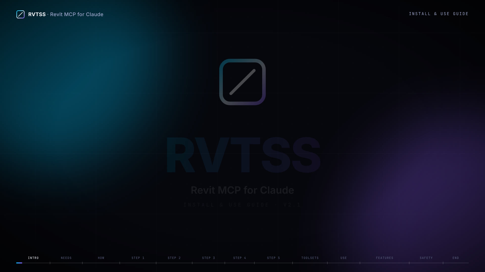

# RVTSS — Revit MCP for Claude

**RVTSS** (created by **Suhaib Al Smadi**) lets Claude inspect and edit live Autodesk Revit models through
pyRevit:
* it creates and edits real family documents (`.rfa`);
* it manages instance, type, family, shared, project and global parameters;
* it automates documentation: views, view filters, sheets, revisions, schedules, tags and text;
* it works with rooms, spaces, areas and materials (finish areas, quantity take-offs);
* it exports PDF, DWG, DXF, IFC, NWC and schedule CSV;
* it runs BIM coordination and quality-control checks: clearance clashes, MEP disconnects, ISO 19650 naming,
  view audits, family library audits, change-impact surveys, and Excel and IFC/COBie exports.

It is an upgrade of [mcp-server-for-revit-python](https://github.com/mcp-servers-for-revit/mcp-server-for-revit-python)
and keeps its API name (`revit_mcp`), port (48884), installation method and all 20 original tools.
**v2.4.0** has 124 tools in 19 toolsets, plus MCP resources and 12 prompts. It is verified live on Revit 2026 and 2027: the full self-test (65 steps) passes with 0 failures on both. Kinds that need families the test template does not have (trusses, braces, isolated foundations, mullions, MEP fittings and pipe caps) were only checked to refuse cleanly.

### New in 2.4

v2.4 follows Revit's ribbon tab by tab and adds what was missing.

* **Any ribbon button:** `list_revit_commands` and `run_revit_command` start one of Revit's own commands
  for the user (scope boxes, design options, phases, rendering...). Save, sync, close, undo and redo are
  refused there and keep their own guarded tools.
* **View:** `view_extents` (crop region, section box, view range, far clip), `manage_view_templates`,
  `manage_viewports`; `create_view` makes callouts and legends; `create_schedule` makes key schedules,
  material take-offs, sheet lists, view lists and note blocks.
* **Annotate:** `create_detailing` adds masking regions, revision clouds, spot elevations and coordinates,
  detail components and symbols; `replace_text` finds and replaces text in text notes.
* **Modify:** `modify_elements` (align, offset, trim/extend, split, scale, flip, cut, paint, parts).
* **Architecture and structure:** `create_elements` adds curtain grid lines, mullions, panel types, wall
  sweeps and reveals, model lines, reference planes, braces, trusses and beam systems.
* **Systems:** `mep_connect` (fittings, caps), `create_mep_parts` (flex, placeholders, accessories on a
  run), `mep_insulation`, `manage_mep_systems` (systems, circuits, panel schedules).
* **Insert:** `insert_files` (link or import CAD, images), `load_family`.
* **Manage and collaborate:** `project_settings` (project information, units, starting view, location),
  `manage_styles` (object styles, line and fill patterns), `transfer_project_standards`, `worksharing`
  (status, relinquish, reload latest, shared coordinates).

The Revit API cannot create phases, design options, scope boxes, ramps, the first legend or model text in
a project, or attach wall tops; use `run_revit_command` for those.

### New in 2.3

* **New tools:** `capture_elements` (Claude looks at elements in a temporary 3D view), `create_stairs`,
  `create_detailing` (dimensions, detail lines, filled regions), `list_annotation_types`, `manage_phases`,
  `manage_links`, `selection_sets` and `undo_last_change` (undoes the latest step only when RVTSS made it).
* **`create_elements`:** roofs, ceilings and structure; ducts, pipes, cable trays and conduit; openings,
  shafts, railings, spaces, areas, automatic rooms, rebar, toposolids and DirectShape meshes.
* **`transform_elements`:** array (linear or radial), pin / unpin, join / unjoin / switch join.
* **Safety:** saving and synchronizing are **off by default** (`RVTSS_ALLOW_SAVE`, `RVTSS_ALLOW_SYNC`).
* **Install check:** `scripts\install.ps1` reports the whole setup and fixes it with `-Apply`.

Details: [CHANGELOG.md](CHANGELOG.md).

### New in 2.2

* **22 new tools:** rooms/spaces/areas, materials and take-offs, tagging and untagged checks, text notes,
  PDF/DWG/DXF/IFC/NWC/CSV export, MEP systems and open connectors, worksets, purge, rule-based view filters,
  revisions, coordinates, spatial queries and a change-impact survey.
* **`batch_execute`:** up to 20 edits as **one Revit undo step**: all succeed or everything is rolled back.
* **Safety:** a **read-only mode** (`RVTSS_READ_ONLY`, MCP side and Revit side), unknown arguments refused
  with *did you mean* (a misspelled `dryrun` can no longer run a change for real), a response-size guard, and
  `rvtss_health` for one-call diagnosis.
* **Prompts:** `getting_started`, `safe_change`, `room_documentation`, `issue_sheets`,
  `mep_connectivity_review`.

Several 2.2 ideas come from [bimwright/rvt-mcp](https://github.com/bimwright/rvt-mcp) (Apache-2.0), a C#
Revit MCP. RVTSS re-implements them for pyRevit; no code was copied. See [NOTICE](NOTICE).

| | |
|---|---|
| **Website** (video + manual) | https://souhaibsmadi42.github.io/RVTSS_MCP/ |
| **Install & use tutorial** (3:54, narrated) | [media/rvtss-tutorial.mp4](media/rvtss-tutorial.mp4) |
| **40 s social reel** (vertical, captioned) | [media/rvtss-reel-40s.mp4](media/rvtss-reel-40s.mp4) |
| **User manual** | [docs/USER_MANUAL.md](docs/USER_MANUAL.md) |
| Tool reference (generated) | [docs/TOOLS.md](docs/TOOLS.md) |
| Coordination features with examples | [docs/COORDINATION.md](docs/COORDINATION.md) |
| What changed, verification status | [CHANGELOG.md](CHANGELOG.md) · [docs/UPGRADE_REPORT.md](docs/UPGRADE_REPORT.md) |
| Original upstream documentation | [docs/UPSTREAM.md](docs/UPSTREAM.md) |
| Agent-assisted install · security · contributing | [AGENTS.md](AGENTS.md) · [SECURITY.md](SECURITY.md) · [CONTRIBUTING.md](CONTRIBUTING.md) |
| 40 s promo film | [media/rvtss-promo-40s.mp4](media/rvtss-promo-40s.mp4) |

[](media/rvtss-tutorial.mp4)

New to RVTSS? Watch the [tutorial](media/rvtss-tutorial.mp4), then follow the [user manual](docs/USER_MANUAL.md).
Promo film: [40 s MP4](media/rvtss-promo-40s.mp4).

## Quick start

1. **Install the extension** (one copy only, see [Installation](#installation)):
   ```powershell
   cd "$env:APPDATA\pyRevit\Extensions"
   git clone https://github.com/souhaibsmadi42/RVTSS_MCP RVTSS.extension
   ```
2. **Turn on Routes.** In pyRevit Settings → Routes, enable **Routes Server**, set the host to
   `127.0.0.1`, then reload pyRevit.
3. **Check the server.** Open `http://127.0.0.1:48884/revit_mcp/status/`. It should show `"health":
   "healthy"` and `"rvtss_version": "2.4.0"`. Once Claude is connected, `rvtss_health` checks the whole chain
   and names the next step when something is wrong.
4. **Run the self-test.** On the RVTSS tab, click **Diagnostics → Run Self-Test**. It works on a copy of
   the bundled test model and opens a pass/fail report.
5. **Connect Claude.** Claude Desktop → Settings → Developer → Edit Config:
   ```json
   {
     "mcpServers": {
       "RVTSS Revit": {
         "command": "uv",
         "args": ["run", "--project", "C:\\path\\to\\RVTSS.extension", "python", "C:\\path\\to\\RVTSS.extension\\main.py"],
         "env": {"RVTSS_TOOLSETS": "bim_coordinator"}
       }
     }
   }
   ```
   For Claude Code: `claude mcp add -s user RVTSS -- uv run --project C:\path\to\RVTSS.extension python C:\path\to\RVTSS.extension\main.py`

## How it works

```
Claude (Desktop / Code)
   │  MCP (stdio or HTTP): tools, resources, prompts
   ▼
main.py + tools/          MCP server (Python 3.11+, mcp 1.9 – 2.x), one pooled HTTP client
   │  HTTP JSON  http://127.0.0.1:48884/revit_mcp/...   (+ optional RVTSS token, request id)
   ▼
startup.py + revit_mcp/   pyRevit Routes inside Revit (IronPython 2.7 / 3.4)
   │  Revit API, executed in API context, inside transactions
   ▼
Autodesk Revit 2021 – 2027
```

* `revit_mcp/core.py` handles:
  * request parsing and document targeting (`document` = title or path);
  * structured errors with hints;
  * transactions that collect Revit failures;
  * true dry runs (a commit inside a rolled-back TransactionGroup);
  * confirmation gates and the redacted audit log.
* `revit_mcp/compat.py` covers Revit version differences (ElementId Int32/Int64, ForgeTypeId specs, group
  ids...).
* `revit_mcp/pure/` holds the Revit-independent logic, all of it unit-tested: units, filters, formulas,
  shared parameter files, QC rules, clash zones, ISO 19650 naming, presets, security and the self-test plan.

## Installation

**Without pyRevit (new):** the Revit side also exists as a C# add-in, *RVTSS Host*, for Revit 2024-2027. It
serves the same routes on port 48885, so the MCP server only needs `REVIT_PORT=48885`. It is faster on
element-heavy tools and needs nothing else in Revit. Install, status per Revit version and the differences
from the pyRevit version (among them: `execute_revit_code` is Python 3 there): [host/README.md](host/README.md).
The steps below install the pyRevit version.

**Quick check (v2.3):** after cloning, run
`powershell -ExecutionPolicy Bypass -File scripts\install.ps1`. It reports pyRevit, extension copies,
Routes, uv, the MCP environment and the Claude client entries, with the fix for each, and changes nothing.
`-Apply -Client code` (or `desktop`) fixes what is missing after a yes per change, with backups.

1. **Keep only one copy of the extension.** Two copies both register the `revit_mcp` API and conflict, for
   example `revit-mcp-python.extension` and `mcp-server-for-revit-python.extension` in
   `%APPDATA%\pyRevit\Extensions`. Remove or disable the old one.
2. Clone this repository into the pyRevit extensions folder as a folder ending in `.extension` (see the
   quick start). You can instead add its parent folder under pyRevit Settings → Custom Extension Directories.
   The extension shows up as **RVTSS** (tab `RVTSS`). If there is no RVTSS tab and `/revit_mcp/status/`
   answers `Route does not exits`, the extension is disabled: pyRevit → Extensions → RVTSS → Enable, or set
   `disabled = false` under `[RVTSS.extension]` in `%APPDATA%\pyRevit\pyRevit_config.ini`, then restart
   Revit. (Copies cloned before this fix shipped with `extension.json` disabled by default.)
3. pyRevit Settings → Routes: enable the Routes Server on port 48884, set the host to `127.0.0.1` unless
   Revit runs in a VM, then reload pyRevit.
4. Install the MCP server dependencies (Python 3.11+). The package is `rvtss-mcp`:
   ```powershell
   uv sync                          # uses uv.lock
   uv pip install -r requirements.txt
   ```

## Toolsets and profiles

Every tool on every turn costs context. Load only what you need with `RVTSS_TOOLSETS`, a comma-separated
list of toolsets and/or profiles, in the MCP server's environment. The default is `all`. `core` is always
loaded.

| Profile | Toolsets | Tools |
|---|---|---|
| `all` (default) | everything | 124 |
| `bim_coordinator` | core, model, parameters, documentation, qc | 47 |
| `family_author` | core, families, parameters | 34 |
| `modeler` | core, model, edit, documentation, insert, commands | 48 |
| `minimal` | core, model | 18 |
| `architect` | core, model, edit, documentation, rooms, materials, annotation, insert, commands | 59 |
| `mep_coordinator` | core, model, edit, qc, mep, mep_edit | 42 |
| `publisher` | core, model, documentation, annotation, export | 41 |
| `auditor` | core, model, qc, rooms, materials, mep | 32 |

**Toolsets:**
* `core`: status, health, session, `find_elements`, element details, selection
* `model`: overview, families, views, sheets, schedules, links, warnings, view image, element capture,
  change-impact survey, coordinates
* `edit`: set and bulk parameters, transform, modify (align, offset, trim, split...), delete, create,
  stairs, types, `batch_execute`, selection sets, undo
* `families`: the full `.rfa` workflow and the library audit
* `parameters`: shared, project and global parameters, audit, CSV/Excel export, mapping presets
* `documentation`: views, view extents, view templates, view filters, sheets, viewports, revisions,
  schedules, renames, groups, colours
* `qc`: model checks, clashes, clash report, spatial queries, snapshots
* `rooms`: rooms, spaces and areas with status, boundaries, doors/windows and finish areas
* `materials`: material list, quantity take-off, create/edit/assign
* `annotation`: untagged-element check, tagging, text notes and find/replace, dimensions, detail lines,
  filled and masking regions, revision clouds, spot dimensions, detail components
* `export`: PDF, DWG, DXF, IFC, NWC and schedule CSV
* `mep`: systems, connectors, open connectors (read-only)
* `mep_edit`: fittings and caps, flex and placeholders, insulation and lining, systems and circuits
* `insert`: link or import CAD, images, load families
* `commands`: list and start Revit's own ribbon commands
* `admin`: worksets, purge unused, phases and design options, Revit links, project settings, object styles
  and patterns, transfer project standards, worksharing
* `launch`: start Revit, open, save and sync documents
* `code`: `execute_revit_code`
* `legacy`: seven original tools superseded by newer ones, kept as deprecated aliases for one release

In the default profile the tool list is about 126k characters for 124 tools: 5 % more than v2.0's 74
tools, for 50 more tools. A profile keeps it small: `bim_coordinator` is well under half of v2.0. Clients with
tool search (Claude Code) load tools on demand, so the full set costs little there.

Long tool documentation is not sent on every turn; it lives in the MCP resource
`rvtss://docs/tools/{name}`.

**Other resources:**
* `rvtss://session`
* `rvtss://project/overview`
* `rvtss://qc_rules`
* `rvtss://config`
* `rvtss://logs/today`
* `rvtss://docs/toolsets`

**Prompts:**
* `getting_started` (new): orient in the open model, read-only
* `safe_change` (new): survey impact, agree the scope, dry run, one undo step, read back
* `room_documentation` (new), `issue_sheets` (new), `mep_connectivity_review` (new)
* `model_health_check`
* `create_parametric_family`
* `shared_parameter_rollout`
* `naming_audit`
* `pre_issue_qc`
* `clash_coordination`
* `bim_standards_audit`

## Security

pyRevit Routes has no authentication of its own: anything that can reach port 48884 can drive Revit.

| Setting | Where | Effect |
|---|---|---|
| pyRevit Routes host = `127.0.0.1` | pyRevit Settings → Routes | **Recommended.** If it is empty (all interfaces), `/status/` shows a warning. |
| `RVTSS_TOKEN` | Revit environment **and** MCP server environment (or `"token"` in `%APPDATA%\RVTSS\config.json`) | Every route except `/status/` and `/ping/` requires the same token. pyRevit does not pass HTTP headers to handlers, so the token travels in the JSON body or query string. Off by default. |
| `RVTSS_ALLOW_CODE_EXECUTION=0` | Revit environment / config | Disables `execute_revit_code`. It is allowed by default for backward compatibility. Every call is logged with its full code (redacted) in `%APPDATA%\RVTSS\logs\code-*.log`. `transaction_mode="read_only"` refuses code that opens a transaction. |
| `RVTSS_ALLOW_REMOTE=1` | MCP server environment | Needed when `REVIT_HOST` is not loopback (Revit in a VM). Without it the MCP server refuses to send commands to a remote host. |
| `RVTSS_READ_ONLY=1` | MCP server environment | **Read-only mode** (new in 2.2): only tools annotated read-only are registered, so tools that change the model, save documents or make Revit write files (exports) are not even listed. Report tools that only write report files on the MCP machine (`export_clash_report`, `export_to_excel`) stay available. |
| `RVTSS_READ_ONLY=1` | Revit environment (or `"read_only": true` in config.json) | Defence in depth: Revit refuses every model change, save, sync, family save and export, with HTTP 403. Dry runs and previews still work; `execute_revit_code` only accepts `read_only` / `dry_run`. |
| `RVTSS_ALLOW_SAVE=1` / `RVTSS_ALLOW_SYNC=1` | Revit environment (or `"allow_save"` / `"allow_sync": true` in config.json) | **New in 2.3: saving and synchronizing are off by default.** `save_document`, `close_document(save=true)` and `sync_with_central` return 403 `POLICY_DENIED` until allowed. `family_save` and exports are not affected. |

### Claude Code permissions

Allow the read-only tools without prompts and keep the confirmation for everything else. Do not allow the
broad `mcp__RVTSS__*` wildcard. The list is generated from the tool annotations (rename the `RVTSS` prefix if
you registered the server under another name):

<details>
<summary>Read-only allow list</summary>

<!-- BEGIN READ_ONLY_ALLOWLIST -->
```json
{
  "permissions": {
    "allow": [
      "mcp__RVTSS__audit_family_library",
      "mcp__RVTSS__audit_parameters",
      "mcp__RVTSS__capture_elements",
      "mcp__RVTSS__check_clashes",
      "mcp__RVTSS__compare_models",
      "mcp__RVTSS__export_clash_report",
      "mcp__RVTSS__export_parameters",
      "mcp__RVTSS__export_to_excel",
      "mcp__RVTSS__family_flex_test",
      "mcp__RVTSS__family_get_info",
      "mcp__RVTSS__family_list_templates",
      "mcp__RVTSS__family_validate",
      "mcp__RVTSS__find_elements",
      "mcp__RVTSS__find_mep_disconnects",
      "mcp__RVTSS__find_untagged_elements",
      "mcp__RVTSS__find_views",
      "mcp__RVTSS__get_coordinates",
      "mcp__RVTSS__get_current_view_elements",
      "mcp__RVTSS__get_current_view_info",
      "mcp__RVTSS__get_element_details",
      "mcp__RVTSS__get_family_inventory",
      "mcp__RVTSS__get_mep_connectors",
      "mcp__RVTSS__get_model_warnings",
      "mcp__RVTSS__get_project_overview",
      "mcp__RVTSS__get_revit_model_info",
      "mcp__RVTSS__get_revit_status",
      "mcp__RVTSS__get_revit_view",
      "mcp__RVTSS__get_room_details",
      "mcp__RVTSS__get_schedule_data",
      "mcp__RVTSS__get_session_info",
      "mcp__RVTSS__list_annotation_types",
      "mcp__RVTSS__list_category_parameters",
      "mcp__RVTSS__list_export_settings",
      "mcp__RVTSS__list_families",
      "mcp__RVTSS__list_family_categories",
      "mcp__RVTSS__list_levels",
      "mcp__RVTSS__list_links",
      "mcp__RVTSS__list_materials",
      "mcp__RVTSS__list_mep_systems",
      "mcp__RVTSS__list_project_parameters",
      "mcp__RVTSS__list_revit_commands",
      "mcp__RVTSS__list_revit_installations",
      "mcp__RVTSS__list_revit_views",
      "mcp__RVTSS__list_rooms",
      "mcp__RVTSS__list_sheets",
      "mcp__RVTSS__material_takeoff",
      "mcp__RVTSS__run_model_checks",
      "mcp__RVTSS__rvtss_health",
      "mcp__RVTSS__spatial_query",
      "mcp__RVTSS__survey_change_impact"
    ]
  }
}
```
<!-- END READ_ONLY_ALLOWLIST -->

</details>

The audit log (`%APPDATA%\RVTSS\logs`):
* redacts values that look like secrets;
* caps each line at 500 characters;
* deletes files older than 30 days;
* records the request id that each response returns as `request_id`.

## Self-test and live verification

* **In Revit, no terminal needed:** RVTSS tab → **Diagnostics → Run Self-Test**. It copies `tests/test.rvt`
  to `%TEMP%\RVTSS_live`, runs every group (status, original tools, read-only, editing with dry run then
  real, family workflow, parameters on a scratch shared parameter file, QC and coordination, and the v2.2
  to v2.4 tools: read-only calls, dry runs, a batch that must roll back and an undo), and writes
  `rvtss_live_report.json` and `.md`. Your own shared parameter file is never touched.
* **From a terminal**, against the running Routes server:
  ```powershell
  uv run --extra test python tests/live/run_live.py --out rvtss_live_report    # add --token if RVTSS_TOKEN is set
  uv run --extra test pytest -m live tests/live                                # skipped when Routes is not reachable
  ```

## Configuration

| Setting | Where | Default |
|---|---|---|
| `REVIT_HOST`, `REVIT_PORT`, `REVIT_API_NAME` | MCP server env | `127.0.0.1`, `48884`, `revit_mcp` |
| `RVTSS_TOOLSETS` | MCP server env: toolsets and/or profiles | `all` |
| `RVTSS_TIMEOUT` / `RVTSS_IMAGE_TIMEOUT` | MCP server env, seconds (long tools set their own) | `30` / `60` |
| `RVTSS_IMAGE_MAX_KB` | MCP server env: larger view images are refused with a hint | `4096` |
| `RVTSS_REPORT_DIR` | MCP server env: clash reports and Excel files | `~/Documents/RVTSS/reports` |
| `RVTSS_LOG_LEVEL` | MCP server env (stderr) | `WARNING` |
| `RVTSS_CONFIRM_THRESHOLD` | **Revit** env: elements above which `confirm=true` is required | `100` |
| `RVTSS_READ_ONLY` | MCP server env and/or **Revit** env: read-only mode (see [Security](#security)) | off |
| `RVTSS_RESPONSE_WARN_KB` / `RVTSS_RESPONSE_BUDGET_KB` | MCP server env: results above the budget are summarised (status and scalars kept) with narrowing hints | `64` / `256` |
| `%APPDATA%\RVTSS\config.json` | token, code-execution flag, `read_only`, `family_template_dirs`, `naming.parameters.pattern` | optional |
| `%APPDATA%\RVTSS\qc_rules.json` | naming, **iso19650** scheme, required parameters, view-audit options ([example](docs/examples/qc_rules.iso19650.json)) | optional |
| `%APPDATA%\RVTSS\presets\*.json` | office parameter-mapping presets for `map_parameters` | optional |
| `%APPDATA%\RVTSS\logs`, `backups`, `snapshots` | audit logs, `.rfa` backups, model snapshots | created |

## What Claude can do

* **Model intelligence:**
  * `rvtss_health`, `get_session_info`, `get_project_overview`
  * `find_elements` (filters with units, pagination, structured output)
  * `get_element_details`, `get_family_inventory`
  * `find_views`, `list_sheets`, `get_schedule_data`
  * `list_links`, `get_model_warnings`, `get_coordinates`
  * `capture_elements` (v2.3): look at elements in a temporary 3D view with a section box, returned as an
    image; nothing is kept in the model
  * `survey_change_impact`: before a change, what else it touches (type siblings, host/hosted, joins, groups,
    rooms, tags, dimensions, dependents, levels, MEP connections), each group found / none / not checked
* **Editing:**
  * `set_parameters`, `bulk_update_parameter` (numbering templates)
  * `transform_elements` (move, copy, rotate, mirror; v2.3: array, pin, join), `manage_element_types`
  * `create_elements`: levels, grids, walls, floors, roofs, ceilings, families, structure; v2.3: ducts, pipes,
    cable trays, conduit, openings, shafts, railings, spaces, areas, boundary lines, automatic rooms, rebar,
    toposolids, DirectShape meshes
  * `create_stairs` (v2.3): component stairs from straight runs with landings and railings
  * `delete_elements` (previews dependent elements)
  * `batch_execute`: up to 20 of these edits as one undo step, all or nothing
  * `undo_last_change` (v2.3): undo the latest step, only when RVTSS made it
  * `selection_sets` (v2.3): save, load and delete saved selections

  Destructive previews are confirmed through MCP elicitation where the client supports it.
* **Families (`.rfa`)**, in this order:
  1. `family_list_templates`, then `family_create` or `family_open`
  2. `family_add_parameters`
  3. `family_build_parametric_box`, or `family_create_form` with `family_add_dimension`
  4. `family_manage_types`
  5. `family_flex_test`
  6. `family_validate`
  7. `family_save`
  8. `family_load_into_project`

  Library-wide: `audit_family_library`.
* **Parameters:**
  * `shared_parameters`, `list_project_parameters`
  * `global_parameters` (including labelling project dimensions)
  * `audit_parameters`
  * `export_parameters` / `import_parameters` (CSV), `export_to_excel` (`.xlsx`)
  * `map_parameters` (including IFC/COBie presets)
* **Documentation:**
  * `create_view`, `view_graphics`, `manage_view_filters` (rule-based filters with overrides)
  * `manage_sheets`, `manage_revisions`, `create_schedule`
  * `batch_rename`, `manage_groups`, `manage_assemblies`
  * `find_untagged_elements`, `tag_elements` (rooms/spaces/areas too), `create_text_notes`
  * `create_detailing` (dimensions, detail lines, filled regions) and `list_annotation_types` (v2.3)
* **Rooms and materials:**
  * `list_rooms` (rooms, spaces, areas; unplaced / not enclosed / redundant), `get_room_details` (boundaries,
    doors and windows, finish areas, contents)
  * `list_materials`, `material_takeoff` (area and volume per material), `manage_materials`
* **Export:** `list_export_settings`, `export_documents` (PDF, DWG, DXF, IFC, NWC, schedule CSV; one file
  per sheet from a naming template, dry run first)
* **MEP:** `list_mep_systems`, `get_mep_connectors`, `find_mep_disconnects`
* **Model administration:** `manage_worksets`, `purge_unused` (preview first), `manage_phases` (phases, phase
  filters, design options), `manage_links` (reload, unload, load Revit links) (v2.3)
* **Coordination and QC:**
  * `run_model_checks`: 16 checks, including `iso19650` and `view_audit`
  * `check_clashes`: hard and clearance clashes, grid zones, grouping
  * `export_clash_report`: CSV and HTML
  * `spatial_query`: distances, elements in a box or near a point, ray casts
  * `model_snapshot` + `compare_models`

### Example: clash coordination round

```text
check_clashes(set_a={categories: ["Ducts", "Pipes"]}, set_b={categories: ["Structural Framing"]}, dry_run=true)
export_clash_report(set_a={categories: ["Ducts", "Pipes"]}, set_b={categories: ["Structural Framing"]},
                    clearance=50, group_by=["pair", "level", "grid_zone"])
```

### Example: retype doors and renumber them in one undo step

```text
survey_change_impact(element_ids=[1201, 1202], change_kind="instance")
batch_execute(dry_run=true, commands=[
    {tool: "manage_element_types", arguments: {action: "change_type", element_ids: [1201, 1202], type_id: 345}},
    {tool: "set_parameters", arguments: {element_ids: [1201, 1202], parameter: "Mark", value: "D-01"}}])
batch_execute(... same commands ...)          # after the user confirms
```

### Example: issue sheets as PDF

```text
export_documents(format="pdf", sheets=["A101", "A102"], naming="{number} - {name} [{revision}]", dry_run=true)
export_documents(format="pdf", sheets=["A101", "A102"], naming="{number} - {name} [{revision}]")
```

### Example: parametric family with three types

```text
family_create(kind="door", save_path="C:/Families/RVTSS Door.rfa")
family_add_parameters(document="RVTSS Door", parameters=[
    {name: "Frame Thickness", type: "length", value: 50, unit: "mm"},
    {name: "Leaf Width", type: "length", formula: "Width - 2 * Frame Thickness"}])
family_manage_types(document="RVTSS Door", action="create", types=[
    {name: "900 x 2100", values: {Width: 900, Height: 2100}},
    {name: "1000 x 2100", values: {Width: 1000, Height: 2100}}])
family_flex_test(document="RVTSS Door")
family_validate(document="RVTSS Door", expected_category="Doors")
family_save(document="RVTSS Door")
family_load_into_project(document="RVTSS Door")
```

## Safety model

* **Transactions.**
  * Every change runs in a named transaction, so it can be undone in Revit.
  * Revit warnings are returned to Claude.
  * An error rolls the change back.
  * Nothing is reported as done unless Revit committed it.
* **Dry run and confirmation.**
  * `dry_run=true` lets Revit validate the whole change, then rolls it back.
  * Operations over `RVTSS_CONFIRM_THRESHOLD` elements, deletions, CSV imports and batch renames return a
    **preview**. They only run after confirmation: through elicitation, or by calling again with
    `confirm=true`.
* **Units.** Dimensional values need a unit (`900` with `unit="mm"`, or `"900 mm"`). Bare numbers are
  rejected.
* **Files.**
  * `.rfa` files are backed up before being overwritten.
  * Shared parameter GUIDs are never rewritten.
  * Bindings are extended, never replaced.
  * The family library audit never saves.
* **Atomic batches.** `batch_execute` runs several edits in one Revit transaction group: one undo step,
  rolled back completely on the first failure (unless `continue_on_error`) or for `dry_run`.
* **Arguments.** Unknown argument names are refused before anything reaches Revit, with *did you mean*
  suggestions, so a misspelled `dryrun` or `confrim` cannot silently run a real change.
* **Read-only mode.** `RVTSS_READ_ONLY=1` on the MCP server hides every modifying tool; on the Revit side it
  refuses every change.
* **Response size.** Results above `RVTSS_RESPONSE_BUDGET_KB` are summarised (status and scalar fields kept)
  with hints to narrow the request, instead of flooding the context.
* **Retries.** Requests that change the model are never retried. A timeout tells you whether Revit is busy
  (a modal dialog or edit mode) or Routes is down; `rvtss_health` names the next step.

## Tests

```powershell
uv run --extra test pytest tests/unit          # offline, both MCP SDK majors
uv run --extra test pytest -m live tests/live  # needs Revit + pyRevit Routes running
```

CI (`.github/workflows/ci.yml`) runs:
* the unit tests on Python 3.11–3.13, against mcp 1.9.x and the latest 2.x;
* pyflakes;
* vermin (IronPython 2.7 / 3.4 compatibility of the Revit side);
* a check that `docs/TOOLS.md` and the README allow list are up to date.

Revit API behaviour itself is verified by the self-test inside Revit; see the verification status in
[docs/UPGRADE_REPORT.md](docs/UPGRADE_REPORT.md).
