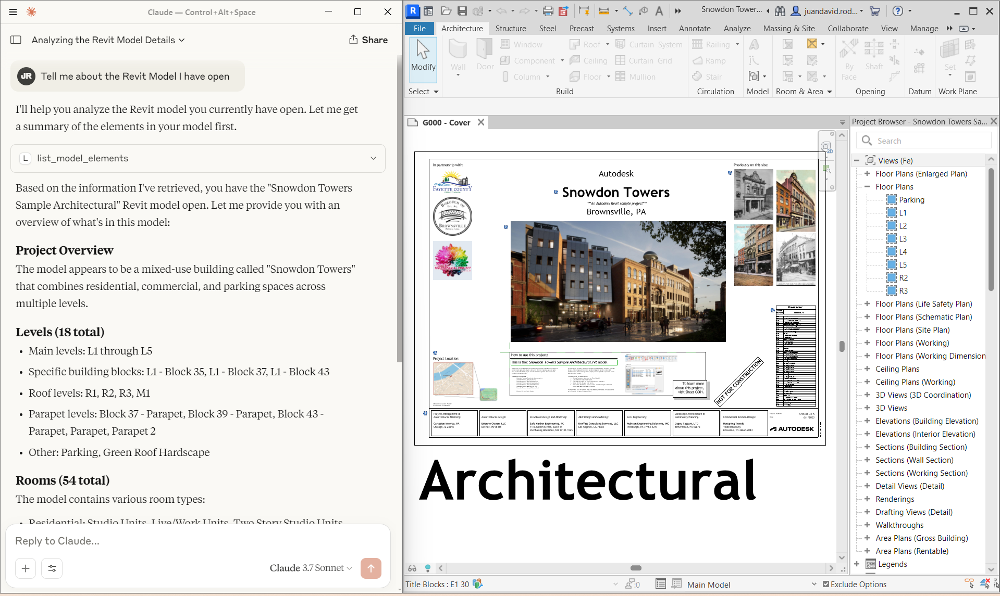
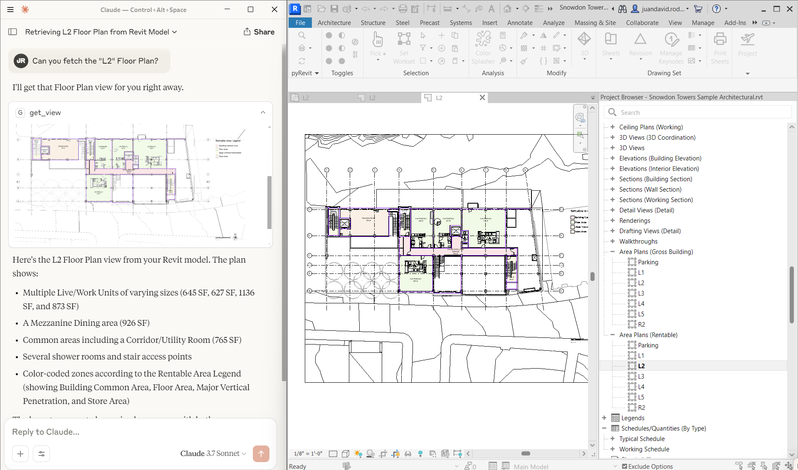

# RVTSS — Revit MCP for Claude

**RVTSS** (created by **Suhaib Al Smadi**) is an upgraded version of the
[mcp-server-for-revit-python](https://github.com/mcp-servers-for-revit/mcp-server-for-revit-python)
pyRevit extension. It lets Claude inspect and edit live Revit models, **create and edit real family
documents (.rfa)**, manage **instance / type / family / shared / project / global parameters**, automate
documentation, and run **BIM coordination and quality-control** checks.

The architecture, installation method, API name (`revit_mcp`), port (48884) and all 20 original tools are
unchanged. The upgrade adds 54 new tools (74 in total) and fixes a number of bugs in the original code.

| | |
|---|---|
| Tool reference | [docs/TOOLS.md](docs/TOOLS.md) (generated from the live registry) |
| Upgrade report, bugs fixed, verification status | [docs/UPGRADE_REPORT.md](docs/UPGRADE_REPORT.md) |
| Example configuration | [examples/](examples/) |

## How it works

```
Claude (Desktop / Code)
   │  MCP (stdio or HTTP)
   ▼
main.py + tools/          MCP server (Python 3.11+, mcp 1.9 – 2.x)
   │  HTTP JSON  http://127.0.0.1:48884/revit_mcp/...
   ▼
startup.py + revit_mcp/   pyRevit Routes inside Revit (IronPython 2.7 / 3.4)
   │  Revit API, executed in API context, inside transactions
   ▼
Autodesk Revit 2021 – 2026
```

* `revit_mcp/core.py` – request parsing, document targeting (`document` = title or path, so background
  family documents can be edited while the project stays active), structured errors with recovery
  hints, transactions with Revit failure collection, **true dry runs** (commit inside a rolled-back
  TransactionGroup), confirmation gates for large or destructive operations.
* `revit_mcp/compat.py` – Revit version differences (ElementId Int32/Int64, ParameterType vs
  ForgeTypeId specs, BuiltInParameterGroup vs GroupTypeId, Floor creation...).
* `revit_mcp/params_util.py` – unit-safe parameter reads and writes.
* `revit_mcp/pure/` – Revit-independent logic (units, filters, formula analysis, shared parameter files,
  type catalogs, template matching, snapshot diffs, QC rules), fully unit-tested.

## Installation

1. **Keep only one copy of the extension.** Two copies (for example `revit-mcp-python.extension` *and*
   `mcp-server-for-revit-python.extension` in `%APPDATA%\pyRevit\Extensions`) both register the
   `revit_mcp` API and conflict. Remove or disable the other one.
2. Put this repository in the pyRevit extensions folder as a folder ending in `.extension`:
   ```powershell
   cd "$env:APPDATA\pyRevit\Extensions"
   git clone https://github.com/souhaibsmadi42/RVTSS_MCP RVTSS.extension
   ```
   (or add the parent folder under pyRevit Settings → Custom Extension Directories).
3. pyRevit Settings → Routes → enable **Routes Server** (port 48884), then reload pyRevit.
4. Check `http://localhost:48884/revit_mcp/status/` in a browser: you should see `"health": "healthy"`
   and `"rvtss_version": "2.0.0"`. `"health": "degraded"` lists route modules that failed to load.
5. Install the MCP server dependencies (Python 3.11+) – either works:
   ```powershell
   uv sync                       # uses uv.lock
   uv pip install -r requirements.txt
   ```
6. Connect Claude Desktop (Settings → Developer → Edit Config) – the original configuration keeps
   working:
   ```json
   {
     "mcpServers": {
       "RVTSS Revit": {
         "command": "uv",
         "args": ["run", "--with", "mcp[cli]", "mcp", "run", "C:\\path\\to\\RVTSS.extension\\main.py"]
       }
     }
   }
   ```
   Claude Code: `claude mcp add -s user RVTSS -- uv run --with "mcp[cli]" mcp run C:\path\to\RVTSS.extension\main.py`

### Configuration

| Setting | Where | Default |
|---|---|---|
| `REVIT_HOST`, `REVIT_PORT` | env of the MCP server | `127.0.0.1`, `48884` |
| `REVIT_API_NAME` | env of the MCP server | `revit_mcp` |
| `RVTSS_TIMEOUT` | env – default HTTP timeout (s); long tools set their own | `30` |
| `RVTSS_LOG_LEVEL` | env – MCP server log level (stderr) | `WARNING` |
| `RVTSS_CONFIRM_THRESHOLD` | env of **Revit** – elements above which `confirm=true` is required | `100` |
| `%APPDATA%\RVTSS\config.json` | extra `family_template_dirs`, `naming.parameters.pattern` | optional |
| `%APPDATA%\RVTSS\qc_rules.json` | naming standards, required parameters, sheet parameters | optional |
| `%APPDATA%\RVTSS\logs\` | one line per RVTSS request (method, result, duration) | created |
| `%APPDATA%\RVTSS\backups\` | copies of .rfa files before they are overwritten | created |
| `%APPDATA%\RVTSS\snapshots\` | model snapshots for change detection | created |

See [examples/config.json](examples/config.json) and [examples/qc_rules.json](examples/qc_rules.json).

## What Claude can do

* **Model intelligence** – `get_session_info`, `get_project_overview`, `find_elements` (categories, class,
  level, view, family/type, free text, parameter filters with units, pagination), `get_element_details`,
  `get_family_inventory`, `find_views`, `list_sheets`, `get_schedule_data`, `list_links`,
  `get_model_warnings`, `revit_selection`.
* **Editing** – `set_parameters` (strict units, before/after values), `bulk_update_parameter`
  (numbering templates such as `D-{Level}-{n:03}`), `transform_elements`, `create_elements` (levels,
  grids, walls, floors, hosted family instances, rooms), `manage_element_types`, `delete_elements`
  (previews every dependent element first).
* **Families (.rfa)** – `family_list_templates` → `family_create` / `family_open` →
  `family_add_parameters` (type/instance, any data type, formulas, shared GUIDs) →
  `family_build_parametric_box` or `family_create_reference_planes` + `family_create_form`
  (extrusion, blend, revolution, sweep, solid/void, material/visibility parameters, subcategories) +
  `family_add_dimension` (labels, EQ, locks) + `family_align_geometry` → `family_manage_types`
  (types, per-type values, type catalogs) → `family_flex_test` → `family_validate` → `family_save`
  (automatic backup) → `family_load_into_project` (reload with overwrite options, verified).
* **Parameters** – `shared_parameters` (read file, create definitions keeping GUIDs, bind/extend
  categories), `list_project_parameters`, `global_parameters`, `audit_parameters`,
  `export_parameters` / `import_parameters` (CSV), `map_parameters` (migrate to a BIM standard).
* **Documentation** – `create_view`, `view_graphics`, `manage_sheets`, `create_schedule`,
  `batch_rename`, `manage_groups`, `manage_assemblies`.
* **Coordination / QC** – `run_model_checks` (14 checks with severities and recommendations),
  `check_clashes` (also against links), `model_snapshot` + `compare_models` (change detection, design
  vs shop-model matching).

### Example: parametric door-like family with three types

```text
family_create(kind="door", save_path="C:/Families/RVTSS Door.rfa")
family_add_parameters(document="RVTSS Door", parameters=[
    {name: "Frame Thickness", type: "length", value: 50, unit: "mm"},
    {name: "Leaf Width", type: "length", formula: "Width - 2 * Frame Thickness"}])
family_manage_types(document="RVTSS Door", action="create", types=[
    {name: "900 x 2100", values: {Width: 900, Height: 2100}},
    {name: "1000 x 2100", values: {Width: 1000, Height: 2100}},
    {name: "1200 x 2400", values: {Width: 1200, Height: 2400}}])
family_flex_test(document="RVTSS Door")
family_validate(document="RVTSS Door", expected_category="Doors")
family_save(document="RVTSS Door")
family_load_into_project(document="RVTSS Door")
```

### Example: shared Fire Rating on doors and walls

```text
shared_parameters(action="create_definitions", definitions=[{name: "Fire Rating", type: "text", group: "Fire"}])
shared_parameters(action="bind", name="Fire Rating", categories=["Doors", "Walls"], dry_run=true)
shared_parameters(action="bind", name="Fire Rating", categories=["Doors", "Walls"])
audit_parameters(categories=["Doors", "Walls"], required=["Fire Rating"])
```

## Safety model

* Every change runs in a named transaction (undoable in Revit); Revit warnings are collected and
  returned, and errors roll the transaction back. Nothing is reported as done unless Revit committed it.
* `dry_run=true` lets Revit validate the change fully (including commit-time failures) and then rolls it
  back.
* Operations over `RVTSS_CONFIRM_THRESHOLD` elements, deletions, CSV imports and batch renames return a
  **preview** until they are re-run with `confirm=true` (imports and renames default to `dry_run=true`).
* Batches are atomic by default (`atomic=false` applies what succeeds, item by item).
* Dimensional values need a unit (`900` + `unit="mm"` or `"900 mm"`) – bare numbers are rejected.
* `.rfa` files are copied to `%APPDATA%\RVTSS\backups` before being overwritten; shared parameter GUIDs
  are never rewritten; existing bindings are extended, not replaced.
* Rollback only covers the current Revit transaction. Saved files, shared parameter files and changes
  already committed in other documents are not undone by a later failure.

## Tests

```powershell
uv run --extra test pytest tests/unit          # offline: 158 tests
uv run --extra test pytest tests/integration   # needs Revit + pyRevit Routes running
```

The offline suite covers the Revit-independent logic, imports every Revit-side module against pyRevit
stubs (route registration, handler signatures, tool↔route mapping, error envelopes), the MCP tool
schemas/payloads/HTTP client, and an end-to-end stdio session against a fake Routes server, on both
MCP SDK majors. Revit API behaviour itself must be verified in Revit – see
[docs/UPGRADE_REPORT.md](docs/UPGRADE_REPORT.md#verification-status).

---

# Original project documentation

# MCP server for Revit - Python

## A pyRevit-oriented implementation of the Model Context Protocol (MCP) for Autodesk Revit

## **How?**

- This minimal implementation leverages the Routes module inside pyRevit to create a bridge between Revit and Large Language Models (LLMs).
- It provides a straightforward template to get started quickly, letting you prototype and iterate tools to give LLMs access to your Revit models.
- These tools are designed to be expanded for your specific use cases. You're very welcome to fork the repo and make your own contributions.
- **Note:** The pyRevit Routes API is currently in draft form and subject to change. It lacks built-in authentication mechanisms, so you'll need to implement your own security measures for production use.

## **Batteries Included**

This repo is aimed at:
- Beginners to the Revit API
- Python specialists who aren't versed in C#
- Anyone wanting to prototype and iterate quickly with LLMs and Revit

It contains:
- A complete Routes implementation for pyRevit
- A minimal MCP server script to connect to any MCP-compatible client
- Several test commands to get you started right away

## Key Architecture Components

The system runs as **two separate servers** working together in a chain:

```
Claude / LLM Client
       |
       |  MCP Protocol (stdio or HTTP)
       v
  main.py  (MCP Server)
       |
       |  HTTP requests (localhost:48884)
       v
  pyRevit Routes  (REST API running inside Revit)
       |
       |  Revit API calls
       v
  Revit Application
```

**`main.py`** is the MCP server. It speaks the MCP protocol so that Claude (or any MCP-compatible client) can call tools. When a tool is called, `main.py` translates it into an HTTP request and forwards it to Revit.

**pyRevit Routes** is a lightweight REST API that runs *inside* the Revit process. It receives those HTTP requests, executes Revit API code (since it has direct access to the running instance), and returns JSON responses.

They never conflict because they serve different roles, speak different protocols, and listen on different ports.

> **Note:** The Launch & Document tools (`launch_revit`, `list_revit_installations`) are the exception — they run entirely on the MCP side, using `subprocess` to start Revit and then polling the pyRevit Routes health endpoint until the bridge is ready.

1.  **MCP Server (`main.py`)**:

- Built with FastMCP
- Handles HTTP communication with Revit Routes API
- Registers tools from modular tool system
- Provides helper functions for GET/POST/Image requests

2.  **pyRevit Extension (`revit-mcp-python.extension/`)**:

- Contains the Routes API that runs inside Revit
- Modular route registration in `startup.py`
- Individual route modules in `revit_mcp/` directory

3.  **Tool Registration System (`tools/`)**:

- Modular tool organization by functionality
- Central registration through `tools/__init__.py`
- Each module registers its own tools with the MCP server


---

## **Supported Tools**


### **Current Implementation Status**

| Tool Name | Status | Category | Description |
|-----------|--------|----------|-------------|
| `get_revit_status` | ✅ Implemented | Status & Connectivity | Check if the Revit-MCP API is active and responding |
| `get_revit_model_info` | ✅ Implemented | Model Information | Get comprehensive information about the current Revit model |
| `list_levels` | ✅ Implemented | Model Information | Get all levels with elevation information |
| `get_revit_view` | ✅ Implemented | View & Image | Export a specific Revit view as an image |
| `list_revit_views` | ✅ Implemented | View & Image | Get a list of all exportable views organized by type |
| `place_family` | ✅ Implemented | Family & Placement | Place a family instance at specified location with custom properties |
| `list_families` | ✅ Implemented | Family & Placement | Get a flat list of available family types (with filtering) |
| `list_family_categories` | ✅ Implemented | Family & Placement | Get a list of all family categories in the model |
| `get_current_view_info` | ✅ Implemented | View Information | Get detailed information about the currently active view |
| `get_current_view_elements` | ✅ Implemented | View Information | Get all elements visible in the current view |
| `create_point_based_element` | ✅ Implemented | Element Creation | Create point-based elements (doors, windows, furniture) |
| `color_splash` | ✅ Implemented | Visualization | Color elements based on parameter values |
| `execute_revit_code` | ✅ Implemented | Code Execution | Execute IronPython code directly in Revit context |
| `list_revit_installations` | ✅ Implemented | Launch & Document | Discover all Revit versions installed on the system |
| `launch_revit` | ✅ Implemented | Launch & Document | Launch Revit, optionally with a file, and poll for readiness |
| `open_document` | ✅ Implemented | Launch & Document | Open a document in running Revit (supports detach and audit) |
| `close_document` | ✅ Implemented | Launch & Document | Close the active document |
| `save_document` | ✅ Implemented | Launch & Document | Save or Save As the active document |
| `sync_with_central` | ✅ Implemented | Launch & Document | Synchronize a workshared document with central |
| `get_selected_elements` | 🔄 Pending | Selection Management | Get information about currently selected elements |
| `create_line_based_element` | 🔄 Pending | Element Creation | Create line-based elements (walls, beams, pipes) |
| `create_surface_based_element` | 🔄 Pending | Element Creation | Create surface-based elements (floors, ceilings) |
| `delete_elements` | 🔄 Pending | Element Management | Delete specified elements from the model |
| `modify_element` | 🔄 Pending | Element Management | Modify element properties (instance parameters) |
| `reset_model` | 🔄 Pending | Element Management | Reset model by deleting process model elements |
| `tag_walls` | 🔄 Pending | Annotation | Tag all walls in the current view |
| `search_modules` | 🔄 Pending | Integration | Search for available modules/addins |
| `use_module` | 🔄 Pending | Integration | Execute functionality from external modules |







## Getting Started

### Installing uv:

> Refer to ./README_UV.md

## Installing the Extension on Revit

### Activate pyRevit Routes

1. In Revit, navigate to the pyRevit tab
2. Open Settings
3. Go to `Routes` > activate `Routes Server`
pyRevit will start listening on port `http://localhost:48884/`

### Install from pyRevit:

1. In Revit, navigate to the pyRevit tab
2. Open Extensions
3. Select the MCP Server for Revit Python Extension > Install extension
4. Select location, default is `%APPDATA%\Roaming\pyRevit\Extensions`
5. Enable and wait for pyRevit to reload. Restart Revit if necessary.


### Manual Installation on a custom directory:

1. Clone the repo in a custom location:
    ```bash
    git clone https://github.com/mcp-servers-for-revit/mcp-server-for-revit-python
    ```
2. Add `.extension` to the root folder name
3. In Revit, navigate to the pyRevit tab
4. Open Settings
5. Under "Custom Extensions", add the path to the `.extension` folder
6. Save settings and reload pyRevit (you might need to restart Revit entirely)

## Testing Your Connection

Once installed, test that the Routes API is working:

1. Open your web browser and go to:
   ```
   http://localhost:48884/revit_mcp/status/
   ```

2. If successful, you should see a response like:
   ```json
   {"status": "active",
    "health": "healthy",
    "revit_available": true,
    "document_title": "your_revit_filename",
    "api_name": "revit_mcp"}
   ```

The Routes Service will now load automatically whenever you start Revit. To disable it, simply remove the extension path from the pyRevit settings.

## Using the MCP Client

### Testing with the MCP Inspector

The MCP SDK includes a handy inspector tool for debugging:

```bash
mcp dev main.py
```

Then access `http://127.0.0.1:6274` in your browser to test your MCP server interactively.

### Transport Modes

The MCP server supports multiple transport modes for different use cases:

| Flag | Transport | Endpoints | Use Case |
|------|-----------|-----------|----------|
| (none) | stdio | stdin/stdout | Claude Desktop / Claude Code default |
| `--sse` | SSE only | `/sse`, `/messages/` | Legacy clients |
| `--streamable-http` | HTTP only | `/mcp` | Modern HTTP clients |
| `--combined` | Both | All above | Maximum compatibility |

**Running with combined transport (recommended for HTTP):**
```bash
uv run --with "mcp[cli]" main.py --combined
```

This starts the server on `http://127.0.0.1:8000` with both SSE and streamable-HTTP endpoints available.

**Testing the endpoints:**
```bash
# Test streamable-http
curl -X POST http://localhost:8000/mcp

# Test SSE
curl http://localhost:8000/sse
```

### Connecting to Claude Desktop

The simplest way to install your MCP server in Claude Desktop:

```bash
mcp install main.py
```

Or for manual installation:

1. Open Claude Desktop → Settings → Developer → Edit Config
2. Add this to the `mcpServers` section:

```json
{
  "mcpServers": {
    "Revit Connector": {
      "command": "uv",
      "args": [
        "run",
        "--with",
        "mcp[cli]",
        "mcp",
        "run",
        "/absolute/path/to/main.py"
      ]
    }
  }
}
```

For HTTP transport mode, configure Claude Desktop with:
```json
{
  "mcpServers": {
    "Revit Connector": {
      "url": "http://localhost:8000/mcp"
    }
  }
}
```

### Connecting to Claude Code

```bash
claude mcp add -s user "Revit-Connector" -- uv run --with "mcp[cli]" mcp run /absolute/path/to/main.py
```

# Creating Your Own Tools

The modular architecture of this project makes adding functionalities relatively simple. The provided LLM.txt file also gives your language model the necessary context to get started right away.

The process involves three main parts:

## Part 1: Create the Route Module in Revit

Create a new Python file within the `revit-mcp-python.extension/revit_mcp/` directory (e.g., `revit_mcp/your_module.py`). This module will contain all the related functions you want to expose.

```python
# In revit-mcp-python.extension/revit_mcp/your_module.py

# -*- coding: UTF-8 -*-
"""
Your Module for Revit MCP
Handles your specific functionality.
"""
from pyrevit import routes, revit, DB
import json
import logging

# Standard logger setup
logger = logging.getLogger(__name__)

def register_your_routes(api):
    """Register all your routes with the API."""

    # ---- Example 1: A GET request for reading data ----
    @api.route('/your_endpoint/', methods=["GET"])
    def get_project_title(doc):
        """Gets the project title from the Revit model."""
        try:
            value = doc.Title
            return routes.make_response(data={"status": "success", "data": value})
        except Exception as e:
            logger.error("Get project title failed: {}".format(str(e)))
            return routes.make_response(data={"error": str(e)}, status=500)

    # ---- Example 2: A POST request for modifying the model ----
    @api.route('/modify_model/', methods=["POST"])
    def modify_model(doc, request):
        """Handles POST requests for modifying the Revit model."""
        try:
            data = json.loads(request.data) if isinstance(request.data, str) else request.data

            # Use a transaction for all model modifications
            t = DB.Transaction(doc, "Modify Model via MCP")
            t.Start()

            try:
                element_id = data.get("element_id")
                new_value = data.get("new_value")
                element = doc.GetElement(DB.ElementId(int(element_id)))
                param = element.LookupParameter("Comments")
                param.Set(new_value)

                t.Commit()
                return routes.make_response(data={"status": "success", "result": "Element modified."})

            except Exception as tx_error:
                if t.HasStarted() and not t.HasEnded():
                    t.RollBack()
                raise tx_error

        except Exception as e:
            logger.error("Modify model failed: {}".format(str(e)))
            return routes.make_response(data={"error": str(e)}, status=500)

    logger.info("Your custom routes were registered successfully.")
```

## Part 2: Create the MCP Tool Module

Create the corresponding tools for the MCP server in the `tools/` directory (e.g., `tools/your_tools.py`). This module will use the `revit_get` and `revit_post` helpers from `main.py`.

```python
# In tools/your_tools.py
# -*- coding: utf-8 -*-
"""Your tools for the MCP server."""

from ._compat import Context  # works with mcp 1.x and 2.x
from .utils import format_response

def register_your_tools(mcp, revit_get, revit_post, revit_image=None):
    """Register your tools with the MCP server."""

    # ---- Tool for the GET request ----
    @mcp.tool()
    async def get_revit_project_title(ctx: Context) -> str:
        """
        Retrieves the title of the currently open Revit project.
        """
        response = await revit_get("/your_endpoint/", ctx)
        return format_response(response)

    # ---- Tool for the POST request ----
    @mcp.tool()
    async def modify_revit_element_comment(
        element_id: int,
        new_value: str,
        ctx: Context = None
    ) -> str:
        """
        Modifies the 'Comments' parameter of a specific element.

        Args:
            element_id: The ID of the element to modify.
            new_value: The new comment to apply to the element.
        """
        payload = {"element_id": element_id, "new_value": new_value}
        response = await revit_post("/modify_model/", payload, ctx)
        return format_response(response)
```

## Part 3: Register Your New Modules

### 1. Register the Route Module

Open `startup.py` and add your module to `ROUTE_MODULES`. Each module is
registered independently; a failure is logged and reported by `/status/`
(`health: degraded`, `route_modules_failed`) instead of breaking the others.

```python
# In startup.py
ROUTE_MODULES = [
    # ... existing modules
    ("revit_mcp.your_module", "register_your_routes"),
]
```

RVTSS helpers make new routes shorter and safer: `revit_mcp.core.handle()`
(request parsing, document resolution, structured errors),
`core.run_transaction()` (failure collection, true dry runs) and
`revit_mcp.params_util` (unit-safe parameter read/write). See
`revit_mcp/elements.py` for examples.

### 2. Register the Tool Module

Open `tools/__init__.py` and add your new tool registration function.

```python
# In tools/__init__.py

# ... (other tool imports)
# Import the registration function from your new tool module
from .your_tools import register_your_tools

def register_tools(mcp_server, revit_get_func, revit_post_func, revit_image_func):
    """Register all tools with the MCP server"""

    # ... (existing tool registrations)
    # Register your new tools (this registers all tools inside)
    register_your_tools(mcp_server, revit_get_func, revit_post_func, revit_image_func)

    return mcp_server
```


## Roadmap

This is a work in progress and more of a demonstration than a fully-featured product. Future improvements could include:

- **Creating a Client inside Revit**
- **Implementing compatibilities with other language Models**
- **Authentication and security enhancements**
- **More advanced Revit tools and capabilities**
- **Better error handling and debugging features**
- **Benchmarking with local models**
- **Documentation and examples for common use cases**
- **...**

## Contributing

Contributions are welcome! Feel free to submit pull requests or open issues for any bugs or feature requests.
Feel free to reach out to me if you have any questions, ideas
